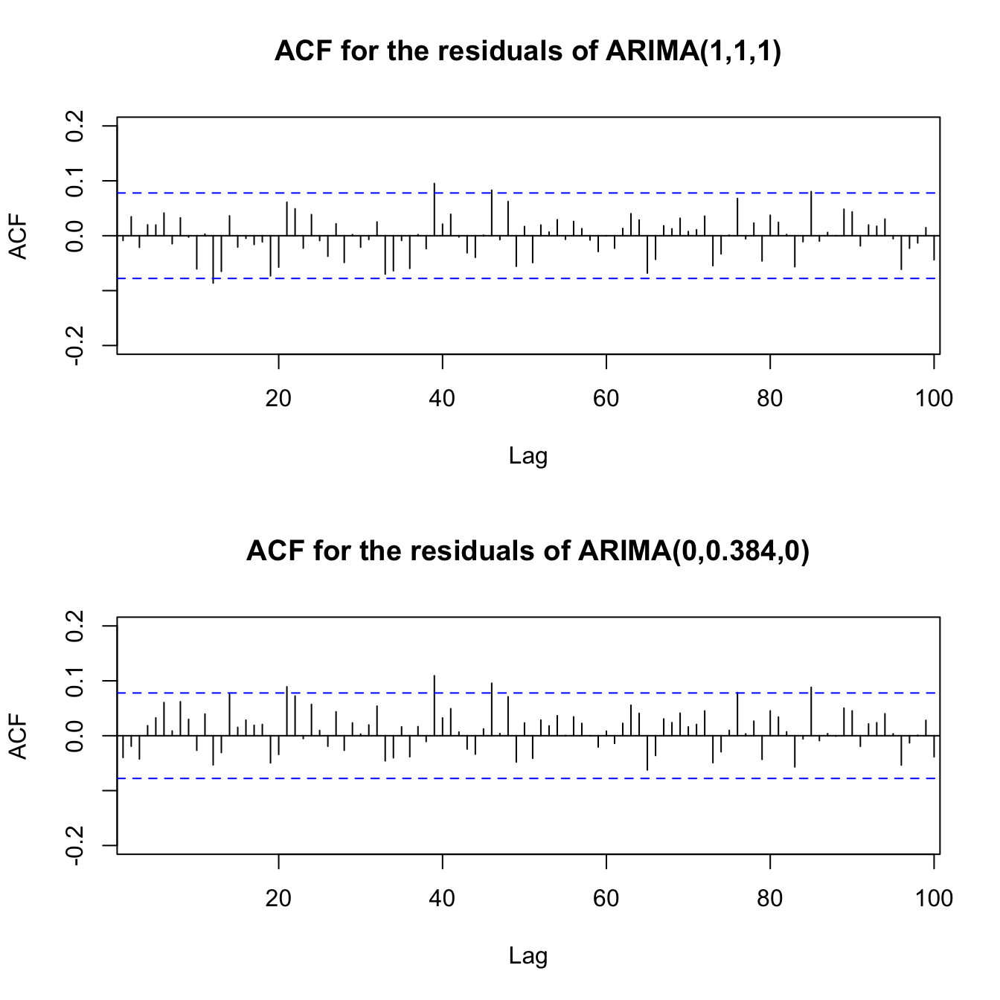

# Long-Memory Time Series: ARFIMA Models

A short written treatment of fractionally integrated (ARFIMA) models, with the main derivations worked out by hand and a fitted example in R.

ARIMA forces the differencing order to be a whole number, which can under- or over-difference a series whose autocorrelation dies off slowly. ARFIMA lets the order *d* be a fraction, giving a model that sits between ARIMA(p,0,q) and ARIMA(p,1,q) and can describe that slow decay with a single parameter.

Final project for a graduate time series course at Baylor University, Fall 2025. The topic and the example series follow Shumway and Stoffer's *Time Series Analysis and Its Applications*.

- Rendered report: [long_memory_arima.html](long_memory_arima.html) (download and open in a browser)
- Source: [long_memory_arima.qmd](long_memory_arima.qmd)

## Contents

1. **Short versus long memory.** The linear-process form of ARMA(1,1), showing why its autocorrelations decay exponentially.
2. **ARFIMA(0, d, 0).** The ψ-weights from the fractional difference operator, the autocovariance function, and the result ρ(h) ≈ h^(2d−1) for large lags, which is not absolutely summable when 0 < d < 0.5.
3. **Time-domain estimation.** Gauss–Newton iteration on the conditional sum of squares.
4. **Forecasting** from the truncated AR(∞) representation.
5. **The general ARFIMA(p, d, q) model.**
6. **Frequency-domain estimation.** The spectral density and the Whittle likelihood, maximised numerically with `optim`.

## Worked example

The series is the log of the glacial varve thickness record (`varve` in the `astsa` package), a standard example of long memory.

| Method | Estimate of *d* |
|---|---|
| Time domain (`fracdiff`) | 0.384 |
| Frequency domain (Whittle likelihood) | 0.380 (s.e. 0.028) |

Both a conventional ARIMA(1,1,1) and the one-parameter ARFIMA(0, 0.384, 0) leave residuals with little remaining autocorrelation, so the fractional model gives a comparable fit with fewer parameters.



## Running

```r
install.packages(c("fracdiff", "astsa"))
```

```bash
quarto render long_memory_arima.qmd
```

## Skills demonstrated

Time series theory (ARMA, fractional differencing, spectral analysis) · maximum likelihood and numerical optimisation · R (`fracdiff`, `astsa`) · mathematical writing in LaTeX and Quarto

## Reference

Shumway, R. H. and Stoffer, D. S. (2017). *Time Series Analysis and Its Applications: With R Examples*, 4th ed. Springer.

## Author

Nishith Ranjon Roy (Pritom) · [LinkedIn](https://www.linkedin.com/in/pritom65/) · [Google Scholar](https://scholar.google.com.pk/citations?user=HjqFwTUAAAAJ&hl=en)
